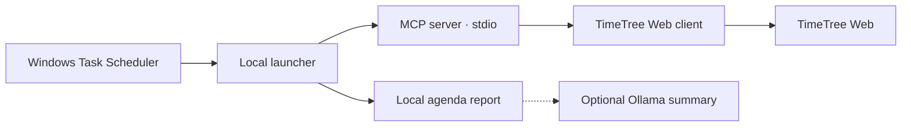

# Local TimeTree MCP

[](LICENSE)
[](package.json)
[](https://nodejs.org/)
[](package.json)

[繁體中文](README.md) | **English**

Author: [海鮮稽查長 SeaFoodInspector](https://github.com/SeaFoodInspector056)

An unofficial, read-only MCP server for TimeTree Web. The server exposes two tools over stdio and includes a Windows launcher for account setup and scheduled reports.

## Architecture



- `src/server.mjs` registers the tools using the official MCP TypeScript SDK.
- `src/timetree.mjs` owns login, session renewal, response validation and event pagination. The integration uses TimeTree Web's undocumented endpoints and can break when TimeTree changes them.
- `TimeTree-Agent.ps1` stores credentials locally using Windows DPAPI and starts the client.
- `agent.mjs` calls the read tools, writes a report and optionally summarizes it using a local Ollama model.

## Run on Windows

Install Node.js 22 or newer with npm. Open PowerShell in this directory:

```powershell
npm.cmd ci
npm.cmd test
powershell.exe -NoProfile -ExecutionPolicy Bypass -File .\TimeTree-Agent.ps1 -Mode Check
```

`Check` runs the MCP handshake without authenticating. Verify that you can sign in to TimeTree Web using email and password, then enter them at the local Windows prompt:

```powershell
powershell.exe -NoProfile -ExecutionPolicy Bypass -File .\TimeTree-Agent.ps1 -Mode Credentials
powershell.exe -NoProfile -ExecutionPolicy Bypass -File .\TimeTree-Agent.ps1 -Mode Calendars
powershell.exe -NoProfile -ExecutionPolicy Bypass -File .\TimeTree-Agent.ps1 -Mode Events -CalendarId YOUR_ID
```

Replace `YOUR_ID` with the ID of your test calendar. Windows encrypts the saved password for the current user on this computer. The email in the file and the generated calendar reports are readable local data. Keep them out of shared or synchronized folders. The credential and reports are stored under `%LOCALAPPDATA%\LocalTimeTreeMcp`, outside this repository.

## Schedule a report

Once `Events` succeeds, run the same command with `-Mode Daily` and open `%LOCALAPPDATA%\LocalTimeTreeMcp\agenda.txt`. In Windows Task Scheduler, create a task for the same Windows account with “Run only when user is logged on.” Choose your daily trigger. Set the program to `powershell.exe` and the arguments to the following, replacing the path and calendar ID:

```
-NoProfile -NonInteractive -WindowStyle Hidden -ExecutionPolicy Bypass -File "C:\path\to\TimeTree-Agent.ps1" -Mode Daily -CalendarId YOUR_ID
```

Select “Do not start a new instance.” Run the task once and verify result `0x0` and a fresh timestamp in the report. For a Chinese summary, run local Ollama with `qwen3:4b` and use `-Mode Summary`. It writes the calendar report before calling the model at `127.0.0.1`.

## Maintenance

`list_calendars` returns active calendar IDs and names. `get_events` accepts a calendar ID and optional exclusive start-time bounds in Unix milliseconds. It reads all event-feed pages before filtering. It reports recurring series at the original start only, and reports warn when recurring occurrences may be missing. This is an early read-only version. Live login and calendar access need validation with a real test account.

The automated tests cover MCP stdio initialization, tool discovery, session renewal, event pagination and malformed responses.

If TimeTree changes the login, endpoints or response format, update `src/timetree.mjs` and use synthetic responses in `test/timetree.test.mjs` to reproduce the change. Avoid committing real API responses, since they can contain private calendar data. A client with MCP stdio support can launch `node src/server.mjs` with `TIMETREE_EMAIL` and `TIMETREE_PASSWORD` passed securely in the child environment. ChatGPT web requires a separate supported MCP connection; this server listens only on stdio.

## License

[MIT](LICENSE). See the [third-party notices](THIRD_PARTY_NOTICES.md).
