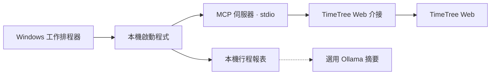

# Local TimeTree MCP

[](LICENSE)
[](package.json)
[](https://nodejs.org/)
[](package.json)

**繁體中文** | [English](README.en.md)

作者：[海鮮稽查長 SeaFoodInspector](https://github.com/SeaFoodInspector056)



## 省流：這個專案解決什麼？

讓家用 Windows 主機定期從 TimeTree 讀取行程並產生報表。需要摘要時，可交給本機 Ollama 整理。這是唯讀的非官方介接，使用 TimeTree Web 的非公開端點。

## 工具與架構

| 項目 | 功能 |
|---|---|
| `list_calendars` | 列出有效行事曆的 ID 和名稱。 |
| `get_events` | 讀取指定行事曆，可依開始時間篩選。時間參數為 Unix 毫秒，上下界均為排除。 |
| `src/server.mjs` | 用官方 MCP SDK 註冊兩個工具，透過 stdio 提供給客戶端。 |
| `src/timetree.mjs` | 處理登入、工作階段更新、事件分頁和回應格式驗證。 |
| `TimeTree-Agent.ps1`、`agent.mjs` | 在 Windows 儲存本機憑證，啟動查詢、報表或摘要。 |

週期行程目前只出現在原始開始時間，報表會標示可能漏掉後續場次。

## 安裝與唯讀測試

安裝 Node.js 22 以上版本與 npm，在專案目錄開啟 PowerShell：

```powershell
npm.cmd ci
npm.cmd test
powershell.exe -NoProfile -ExecutionPolicy Bypass -File .\TimeTree-Agent.ps1 -Mode Check
```

`Check` 只驗證 MCP 握手與工具探索。確認 TimeTree Web 能用電子郵件和密碼登入後，在自己的 Windows 視窗執行：

```powershell
powershell.exe -NoProfile -ExecutionPolicy Bypass -File .\TimeTree-Agent.ps1 -Mode Credentials
powershell.exe -NoProfile -ExecutionPolicy Bypass -File .\TimeTree-Agent.ps1 -Mode Calendars
powershell.exe -NoProfile -ExecutionPolicy Bypass -File .\TimeTree-Agent.ps1 -Mode Events -CalendarId YOUR_ID
```

將 `YOUR_ID` 換成測試行事曆 ID。Windows 以 DPAPI 為目前使用者和電腦加密密碼。帳號名稱和報表仍可讀取。相關檔案存放在專案目錄外的 `%LOCALAPPDATA%\LocalTimeTreeMcp\`。

## Windows 工作排程器

`Events` 成功後，改成 `-Mode Daily` 手動執行，確認 `agenda.txt` 已更新。以同一個 Windows 帳號建立每日工作，選「只有在使用者登入時才執行」。程式填 `powershell.exe`，引數如下，請替換路徑與 ID：

```text
-NoProfile -NonInteractive -WindowStyle Hidden -ExecutionPolicy Bypass -File "C:\path\to\TimeTree-Agent.ps1" -Mode Daily -CalendarId YOUR_ID
```

選「不要啟動新執行個體」，手動執行一次並核對結果 `0x0` 和報表時間。如果已啟動 Ollama 並下載 `qwen3:4b`，可使用 `-Mode Summary` 在本機產生摘要。

## 驗證與維護

測試涵蓋 MCP stdio 握手、工具探索、工作階段更新、事件分頁和異常回應。實際 TimeTree 登入與讀取仍需用測試帳號驗證。TimeTree 改版時，可先檢查 `src/timetree.mjs`，再用模擬回應在 `test/` 重現問題。請勿提交含實際行程的 API 回應。

支援 stdio 的客戶端可執行 `node src/server.mjs`，並透過子程序環境傳入 `TIMETREE_EMAIL` 和 `TIMETREE_PASSWORD`。ChatGPT 網頁版需要另外設定受支援的 MCP 連線。

## 授權

採用 [MIT](LICENSE)。依賴套件的授權詳見 [第三方依賴說明](THIRD_PARTY_NOTICES.md)。
